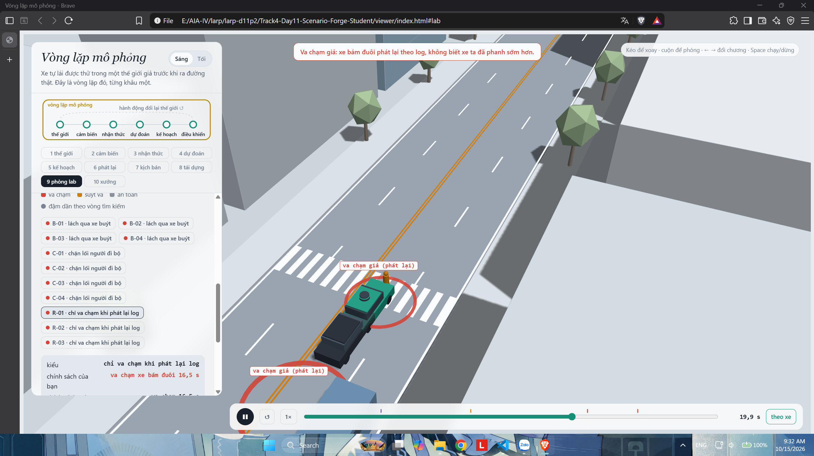
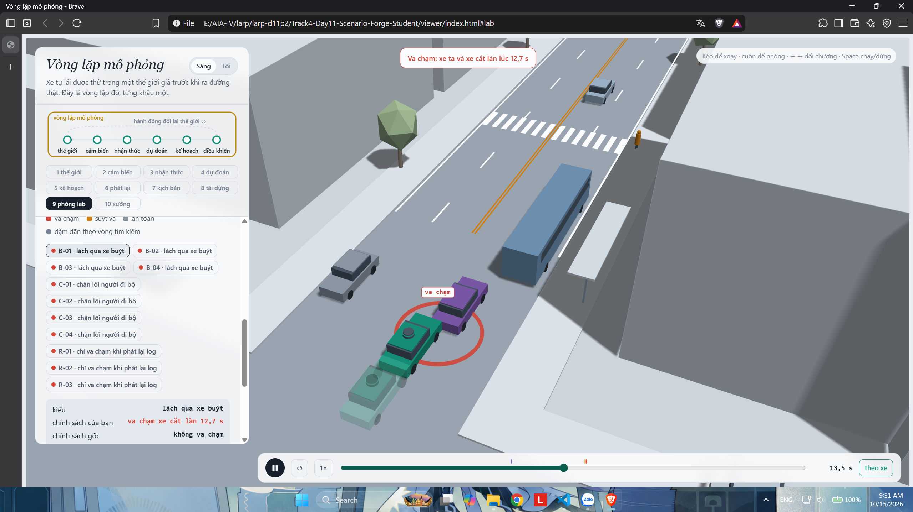
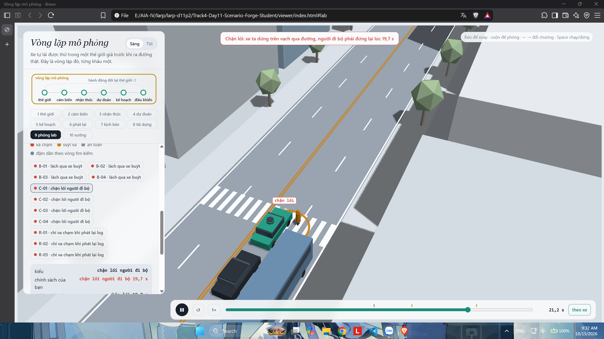
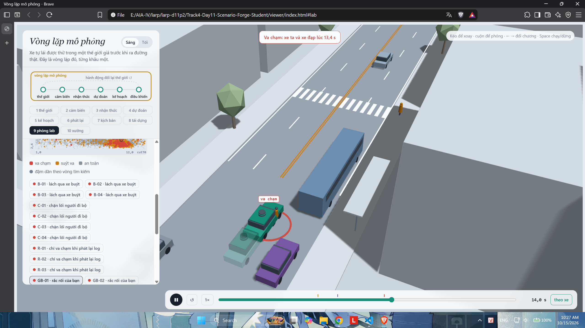

MSSV: 202602611

# Lab 11 · Scenario Forge — báo cáo

- Thị trấn **A** (`mc.json: _run.town`); các kết quả dùng ngân sách đầy đủ (`_run.quick = false`). Số dưới đây làm tròn từ `evidence/`.

## 1. Phát lại log có trung thực không? (bước A)

| Kết quả | Số kịch bản |
|---|---:|
| Ban đầu / bỏ vì người lái gây va chạm | 400 / 3 |
| Còn lại | 397 |
| Replay: tổng / rear / side / front | 113 / 98 / 15 / 0 |
| Reactive: tổng và mọi loại tiếp xúc | 0 |

- Nguồn: `replay.json: n, dropped_human_crash_logs, n_used, replay, reactive`.
- Replay giữ chuyển động xe khác dù planner đã phanh khác người lái trong log. Xe sau không phản ứng nên gây va chạm giả; rear chiếm **98/113 ≈ 86,7%**.
- Ví dụ `replay_only[0]`: scenario **3**, tiếp xúc rear khi replay; reactive không va chạm, `min_ttc_reactive = 2,604 s`. Xe sau cần phản ứng với chuyển động mới của xe ta.

## 2. Kịch bản bất khả thi (bước B)

| Luật trong `lab11/feasible.py` | Căn cứ |
|---|---|
| `(π/cutDur)² × 3,5/2 ≤ μg` | Chuyển làn không vượt độ bám ngang |
| `cutBrake ≤ μg` | Phanh không vượt độ bám đường |
| `pedV ≤ 2,5 m/s` | Giới hạn người đi bộ của lab |
| `0 < cutV ≤ 22 m/s` | Phạm vi tốc độ xe cắt làn của lab |

- `hunt.json: <mode>.infeasible`: bus_bypass **4**, cut_in **3**, crosswalk_block **6**, rear_ended **10**; rear_ended nhiều nhất.
- CEM ưu tiên điểm nguy hiểm nên có thể đẩy tham số tới chuyển làn quá nhanh hoặc phanh quá mạnh. File không ghi lý do loại từng mẫu, nên chưa biết luật nào bị vi phạm nhiều nhất.
- Đếm cảnh bất khả thi là va chạm sẽ làm tăng giả nguy cơ. Phải loại chúng trước khi chạy và tính kết quả.

## 3. Monte Carlo cho bạn biết gì (bước C1)

- `mc.json: crashes = 3, n = 3000, p = 0,001`; Wilson 95% **[0,00034014; 0,00293620]**, tức **0,1% [0,0340%; 0,2936%]**.
- Để sai số khoảng ±20% của p: `n ≈ 1,96²/(0,2² × p) ≈ 96/p ≈ 96.000` lần, gấp khoảng **32 lần** hiện tại.
- Cả 3 trường hợp đều là bus_bypass. cut_in, crosswalk_block, rear_ended và other chưa xuất hiện; mỗi kiểu phải báo **0/3000, Wilson [0; 0,00127890]**, không kết luận xác suất bằng 0 (`per_mode`).

## 4. Importance sampling, ESS và độ suy biến (bước C3)

Nguồn: `estimate.json: seeds[].per.<mode>`; seed là chỉ số 0–2 lưu trong file.

| Seed | Kiểu | p | hits | ESS | top_share |
|---:|---|---:|---:|---:|---:|
| 0 | bus_bypass | 4,84277e-4 | 24 | 125,33 | 0,5787 |
| 0 | cut_in | 0 | 0 | 124,99 | 0 |
| 0 | crosswalk_block | 9,59928e-7 | 64 | 126,30 | 0,5120 |
| 0 | rear_ended | 0 | 0 | 134,06 | 0 |
| 1 | bus_bypass | 1,48019e-4 | 22 | 120,23 | 0,1305 |
| 1 | cut_in | 0 | 0 | 121,26 | 0 |
| 1 | crosswalk_block | 2,86279e-6 | 95 | 108,26 | 0,3910 |
| 1 | rear_ended | 0 | 0 | 127,08 | 0 |
| 2 | bus_bypass | 4,06293e-4 | 28 | 132,10 | 0,5168 |
| 2 | cut_in | 0 | 0 | 120,58 | 0 |
| 2 | crosswalk_block | 2,15837e-5 | 95 | 109,69 | 0,8985 |
| 2 | rear_ended | 0 | 0 | 119,03 | 0 |

- Ước lượng là `mean(w*y)`, không chia cho tổng trọng số. ESS = `(Σw)²/Σw²`; khoảng 108–134 trên 600 mẫu cho thấy trọng số không đều.
- `top_share = max(w*y)/sum(w*y)`. Seed **0 và 2**, ở cả bus_bypass và crosswalk_block, vượt 0,5: một mẫu đóng góp hơn nửa kết quả; crosswalk_block seed 2 gần **90%**.
- Tổng ba seed là **4,85237e-4; 1,50882e-4; 4,27877e-4** (`seeds[].total`). Các điểm ước lượng dao động mạnh nhưng khoảng rộng còn chồng lấp. Tổng MC 0,001 nằm trong khoảng tổng của cả ba seed; riêng khoảng bus_bypass seed 1 không chồng khoảng MC bus_bypass. Kết quả chưa ổn định.
- `budget = 16.800`, ít hơn 96.000 lần MC cho mục tiêu ±20% khoảng **5,7 lần**, nhưng IS hiện **chưa đạt** độ chính xác đó. Ví dụ bus_bypass seed 1 có sai số tương đối `1,96*se/p ≈ 54%`; MC cần khoảng **90.000** mẫu cho độ chính xác tương tự tại p của seed này.
- cut_in và rear_ended không có hit: dùng `upper_zero_hits = 3/(0,2*600) = 0,025`, không dùng `hi = 0` hay `3/ESS`. Khoảng tổng lưu trong file chưa cộng cận zero-hit của hai kiểu này, nên không coi là bảo đảm đầy đủ cho mọi kiểu chưa thấy.
- `other` lấy từ MC: `other.k = 0, n = 3000, hi = 0,00127890`. Đây là nhóm còn lại, không có mục tiêu săn riêng; dùng MC để không bỏ sót phần này.

## 5. Các kiểu thất bại (bước C2 + 3D)

- **bus_bypass:** C2 lách xe buýt đang dừng với tốc độ thấp, xe ta không giảm tốc kịp và đâm C2. `hunt.json: bus_bypass.found.bus_bypass = 103`; ảnh B-01 báo va chạm **12,7 s**.

- **crosswalk_block:** xe ta dừng trên vạch, P1 phải chờ vì lối đi bị chắn; đây không nhất thiết là va chạm vật lý. `crosswalk_block.found.crosswalk_block = 70`; ảnh C-01 báo chặn lối **19,7 s**.

- Chưa tìm được cut_in và rear_ended đúng kiểu. Cuộc săn cut_in tìm **21 bus_bypass**; rear_ended tìm **1 bus_bypass và 14 crosswalk_block** (`hunt.json: <mode>.found`). Không tìm thấy chưa chứng minh không tồn tại.
- Một cuộc săn chung dễ co về kiểu dễ tìm, bỏ quên kiểu khác; ngay cả săn riêng cũng thu được thất bại ngoài mục tiêu như trên.
- Ảnh hiện chụp sau sự kiện: B-01 ở 13,5 s, C-01 ở 21,2 s. Để đúng yêu cầu thời điểm, cần chụp lại tại 12,7 s và 19,7 s.

## 6. Sửa planner (bước E + 3D)

- Chọn **cutinLat = 3,0**, tăng từ 2,15 để xét xe bên cạnh trong phạm vi ngang rộng hơn (`fix.json: chosen.policy, baseline_train.policy`).

| Policy / tập | fail | fail_hi_seen | fail_hi | progress (m) | harsh |
|---|---:|---:|---:|---:|---:|
| Gốc / TRAIN | 4,23713e-3 | 1,22777e-2 | 1,22777e-2 | 211,561 | 9,516 |
| Sửa / TRAIN | 2,01915e-6 | 4,70220e-6 | 4,70220e-6 | 211,745 | 8,711 |
| Gốc / TEST | 1,10860e-3 | 1,98828e-3 | 3,26718e-3 | 214,288 | 8,290 |
| Sửa / TEST | 1,04713e-6 | 2,27108e-6 | 1,28117e-3 | 214,206 | 7,821 |

- Nguồn: `fix.json: baseline_train, chosen, baseline_test, chosen_test`. `harsh` là **số frame phanh dưới −3 m/s² trung bình**, không phải số đợt phanh riêng biệt.
- Chọn bằng TRAIN, đánh giá bằng TEST. Quãng đường TEST chỉ giảm **0,038%**. Tuy nhiên `chosen_test.bus_bypass.hits = 1, top_share = 1`, nên chưa thể khẳng định chính xác mức giảm xác suất.
- `chosen_test.fail_hi = 0,00128117` lớn hơn `baseline_test.fail = 0,00110860` vì còn cộng cận cho va chạm ngoài hai kiểu săn: `other_crashes.k = 0, n = 3000, hi = 0,00127890`. Cận trên có tính bất định, khác với điểm ước lượng.
- **Ảnh so sánh:** B01.png ở câu 5 có bóng mờ không va chạm. Với B-01, code export gắn policy gốc cho xe đặc; viewer dùng policy sửa cho bóng mờ. Nhãn “chính sách của bạn/gốc” trên giao diện đang đảo vai trong cảnh này (`run_all.py: step_export; viewer/app.js: labRun`).
- Giảm `cautionV` xuống **5,0** nghe an toàn hơn nhưng TRAIN crosswalk_block tăng từ **2,02169e-6** lên **3,97789e-5** (`table[0].crosswalk_block.p`). Chạy chậm thay đổi thời điểm gặp P1 và thời gian chiếm vạch; P1 phản ứng bằng cách chờ. Đây là diễn giải theo cơ chế mô phỏng, chưa kiểm chứng nguyên nhân cho mọi mẫu.

## 7. Từ mô phỏng ra đường thật

| Giả định trong `avsim/space.py`, thị trấn A | Dữ liệu nên thu và nơi lấy | Hướng sai có thể xảy ra |
|---|---|---|
| Khe chuyển làn cutGap, median 12 m | Camera đường phố hoặc log xe: khe lúc bắt đầu nhập làn | Thực tế chấp nhận khe nhỏ hơn thì nguy cơ có thể bị đánh giá thấp |
| Tỉ lệ pedLook = 0,85 | Video trạm xe buýt: tỉ lệ người quan sát trước khi băng qua | Thực tế ít quan sát hơn thì nguy cơ với P1 có thể bị đánh giá thấp |
| Đường ướt 20%, μ ướt/khô = 0,5/0,8 | Log thời tiết theo chuyến và đo độ bám mặt đường | Mưa nhiều hơn hoặc độ bám thấp hơn thì quãng phanh và nguy cơ có thể tăng |

- Đây là đề xuất thu dữ liệu, chưa phải nguồn đã dùng để hiệu chỉnh. Hướng thay đổi cần kiểm tra lại vì người và xe phản ứng với nhau.

## 8. Giới hạn

- Xác suất chỉ áp dụng cho con phố và phân phối của lab, không đại diện mọi đường phố hay mọi chuyến đi thật.
- Hành vi xe/người được lập trình đơn giản, chưa bao quát mất tập trung, phản ứng bất thường hoặc khác biệt giữa người lái.
- Cảm biến chủ yếu mô phỏng che khuất, chưa đánh giá đầy đủ nhiễu, độ trễ, nhận dạng sai hay sương mù. Khoảng tin cậy không bao gồm sai lệch mô hình.
- Nếu có thêm một tuần: tăng mẫu và seed cho kiểu có top_share cao, đo độ nhạy với cutGap/pedLook/μ, thử độ trễ cảm biến và thu dữ liệu thực tế để thay giả định.

## 9. Rắc rối của bạn (bước G + chương 10)

- **Rắc rối:** xe đạp lạng tránh xe buýt, đi vào đường chạy của xe ta. Cảnh gốc: xe đạp 7 m/s, lạng 2,85 m trong 2,2 s, khoảng kích hoạt 15 m (`hazard.json: hazards[0]`).
- **Căn cứ chọn:** nghi ngờ planner phản ứng muộn với chuyển động ngang; kiểm tra tăng cutinLat có giải quyết hết không.
- **Giả định:** độ lạng [2,6; 2,85] m, thời gian [2,2; 2,5] s, khoảng kích hoạt [12; 18] m. Đây là thử độ nhạy quanh cảnh đã dựng; gia tốc ngang lớn nhất khoảng 2,91 m/s², dưới giới hạn 3. `exposure = 1` giả định một lần mỗi chuyến, **không phải tần suất đo thực tế** (`hazard.json: space, why`).
- **Khả thi:** giữ **1496/1500 = 99,733%**, loại 4, đạt ≥50% (`mine.json: accepted, infeasible`).

| Trường trong mine.json | Gốc (baseline) | Sửa (chosen) |
|---|---:|---:|
| n | 1496 | 1496 |
| crashes | 806 | 132 |
| avoidable | 803 | 132 |
| unavoidable | 0 | 0 |
| unattributed | 3 | 0 |
| low_speed | 1 | 62 |
| avoidable_foreknown | 803 | 132 |
| p = avoidable/n | 53,676% | 8,824% |
| Wilson 95% (lo, hi) | [51,143%; 56,191%] | [7,490%; 10,368%] |

- low_speed là nhóm giao với các loại trên, không cộng thêm vào tổng. Bản sửa giảm số lỗi tránh được khoảng **83,6%**, nhưng còn 132 vụ.
- Với exposure = 1, `per_trip` bằng p ở bảng. Cao hơn bus_bypass tự nhiên **0,0148–0,0484%** theo ba seed IS (`estimate.json: seeds[].per.bus_bypass.p`; MC: 0,1%). So sánh này phụ thuộc giả định mọi chuyến đều gặp xe đạp lạng, không chứng minh tần suất ngoài đời cao như vậy.
- Cảnh gốc không va chạm (`mine.json: exact.planner = []`); va chạm xuất hiện khi quét phiên bản trong giao thông thị trấn. `baseline.examples[0]`: H0 bắt đầu **11,7 s**, thấy để phanh **12,0 s**, va chạm **13,4 s**; phanh kiểm chứng tránh được.
- Chuẩn avoidable biết đúng lúc nguy cơ xuất hiện và phanh ngay khi thấy nên có thể lạc quan hơn planner thật. Chỉ thử phanh, không thử đánh lái, lại có thể bỏ sót cách tránh. avoidable và avoidable_foreknown bằng nhau trong kết quả này.
- **Tự lái:** chưa có kết quả tự lái được lưu (`hazard.json: ego = planner`), nên chưa kết luận người lái có tránh được không.
- **Cách sửa đề xuất:** dự đoán đường lạng ngang và phanh sớm để dừng trước vùng xe đạp sẽ đi qua. cutinLat = 3 đã giúp nhưng chưa đủ; chưa thử núm khác để khẳng định loại bỏ hết lỗi.
- **Ảnh GB-01:** thông báo va chạm xe đạp lúc 13,4 s; ảnh được chụp ở 14,0 s. Có thể chụp lại tại 13,4 s để đúng thời điểm yêu cầu.

